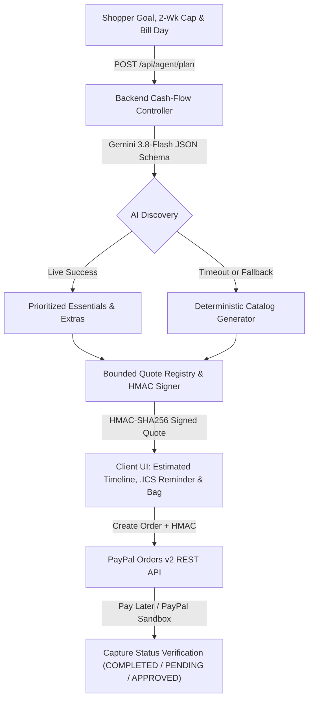

# SplitCart AI - Bi-Weekly Cash-Flow & PayPal Pay in 4 Timing Planner

> **Plan what to buy and when, so you can spot potential bill-date conflicts before checkout.**
> SplitCart AI is a consumer-facing pre-checkout cash-flow planner that turns a shopping goal into an Essentials-first checklist, projects estimated 4-payment installment dates (+0d, +14d, +28d, +42d) against your monthly bill day, suggests a purchase date that clears your bill buffer (with a 1-click `.ics` calendar reminder), and checks out via PayPal Sandbox.

## The Problem ("Why Now?")
- **The Paycheck & Budgeting Reality:** According to [Debt.com's 2026 Budgeting Survey](https://www.debt.com/research/best-way-to-budget/), **84.67% of survey respondents reported that they budget** and **48% of respondents reported living paycheck to paycheck**, yet standard e-commerce carts only display total cart price - leaving shoppers to calculate on their own whether four bi-weekly installment dates will land near major recurring bills like rent.
- **The Solution:** SplitCart AI acts as a pre-checkout planning tool that maps a shopping list against your 2-week comfort cap and selected bill date, flagging potential 2-day buffer conflicts, showing the shifted payment dates if you wait for the recommended purchase day, and allowing shoppers to check out Day-1 Essentials separately from optional Extras.

## Visual Architecture & Data Flow



## Security & Financial Guardrails
- **Server-Side Cart HMAC-SHA256 Signing:** Prevents client-side price tampering by cryptographically binding SKU IDs and integer-cent totals using `crypto.timingSafeEqual`.
- **Cent-Exact Integer Arithmetic:** All installment calculations are executed in integer cents (`Math.round(price * 100)`) so the 4 payments (`first payment $X, then 3 of $Y`) always sum to 100% of the order total without floating-point drift.
- **Estimated Calendar Month-Boundary Conflict Check:** Projects the 4 installment dates (`Day 0, +14d, +28d, +42d`) across real calendar month lengths (28/29/30/31 days) to flag potential conflicts within 2 days of the selected bill due date and display the exact shifted payment dates from the recommended purchase day.
- **PayPal Orders v2 Capture Verification:** Validates Order IDs (`10-36` alphanumeric characters) and verifies that PayPal returns a valid capture status (`COMPLETED`, `PENDING`, or `APPROVED`).

## Current Prototype Scope & Limitations
- **Who This Is For:** Built as a consumer pre-checkout cash-flow planner, architected to evolve into an embeddable merchant checkout widget.
- **Role of Gemini vs. Deterministic Code:** Gemini translates plain-language goals into a prioritized checklist of Essentials first and Extras second; deterministic TypeScript code performs all cent-exact installment math, bill-day buffer checks, and HMAC-SHA256 signing.
- **Estimated Timeline & Manual Phased Checkouts:** The 4-payment timeline is an estimate for planning purposes and does not schedule bank deductions or guarantee overdraft prevention. Selecting "Essentials First" or "Extras Only" lets the shopper check out those items today as a single order; the app does not automatically schedule or auto-charge future Phase 2 purchases.
- **Illustrative Demo Pricing:** Product prices are illustrative demo estimates (`Est. $XX.XX`), not live store feeds.
- **PayPal Sandbox & Testing Access:** Checkout runs in the US PayPal Sandbox (`USD`, Pay in 4 eligible from `$30.00` to `$1,500.00`). Judges may log in at checkout using their own PayPal Developer Sandbox personal buyer account, or request dedicated test buyer credentials via the hackathon organizers / private submission notes.

## Testing & Execution

```bash
cd server
npm run build
npm test
```

*Disclaimer: This is a personal project. The views, code, and opinions expressed here are my own and do not represent those of my current or past employers.*
